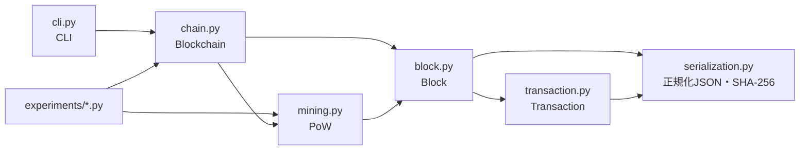
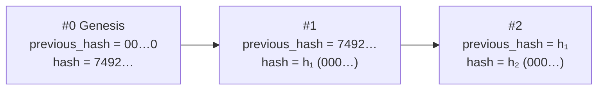

# 設計

## 1. モジュール構成



| モジュール | 役割 |
|---|---|
| `serialization.py` | 決定論的な JSON 文字列化（`canonical_json`）、SHA-256（`sha256_hex`）、JSON 読み込み時のキーと型の検査（`parse_fields`） |
| `transaction.py` | `Transaction`。内容から `transaction_id` を計算する |
| `block.py` | `Block`、ブロックハッシュの計算、Genesis Block の生成 |
| `mining.py` | Proof of Work（`mine`）と、PoW 条件の判定（`meets_difficulty`） |
| `chain.py` | `Blockchain`。トランザクションの追加、採掘、ブロックの追加、検証、保存・読み込み |
| `cli.py` | argparse によるコマンドラインインターフェース |

## 2. データ構造

### Transaction

| フィールド | 型 | 説明 |
|---|---|---|
| `transaction_id` | str | 下記「内容」の SHA-256（16進数64文字） |
| `sender` | str | 送信者（自己申告。署名はない） |
| `recipient` | str | 受信者 |
| `payload` | dict | 任意の JSON オブジェクト |
| `timestamp` | int | Unix 時間（ミリ秒） |

`transaction_id = SHA-256(canonical_json({sender, recipient, payload, timestamp}))`

内容が1文字でも変わると `transaction_id` と一致しなくなるため、トランザクション単位で改ざんを検出できます。

### Block

| フィールド | 型 | 説明 |
|---|---|---|
| `index` | int | ブロック番号（Genesis Block が 0） |
| `timestamp` | int | Unix 時間（ミリ秒） |
| `transactions` | list | Transaction の一覧 |
| `previous_hash` | str | 1つ前のブロックの `hash` |
| `nonce` | int | PoW で変化させる値 |
| `difficulty` | int | ハッシュ先頭に必要な16進数の `0` の個数 |
| `hash` | str | このブロックのハッシュ |

### Blockchain

| 属性 | 説明 |
|---|---|
| `chain` | Block の一覧。先頭は必ず Genesis Block |
| `pending_transactions` | まだブロックに入っていないトランザクション（未承認） |
| `difficulty` | 次に採掘するブロックの difficulty。変更しても既存ブロックには影響しない |

## 3. ハッシュの計算

### 3.1 決定論的シリアライズ

ハッシュ関数はバイト列を入力にとります。同じ内容のデータが常に同じバイト列になるよう、次の規則で JSON 文字列にしてから UTF-8 でバイト列にします（`canonical_json`）。

| 規則 | 理由 |
|---|---|
| キーを辞書順に並べる（`sort_keys=True`） | 辞書の挿入順に依存させない |
| 空白を入れない（`separators=(",", ":")`） | 整形の違いで値が変わらないようにする |
| `NaN` / `Infinity` を拒否する（`allow_nan=False`） | JSON 標準外の値で、処理系によって扱いが異なる |
| 時刻はミリ秒単位の整数にする | 浮動小数点数の文字列表現は言語や実装によって異なりうる |
| payload は作成時に一度 JSON として往復させる | タプルなど JSON にない型を含めず、保存→読み込み後もハッシュが変わらないようにする |

例: `Transaction.create("alice", "bob", {"text": "hello"}, timestamp=0)` のハッシュ対象の文字列は次のとおりです（テストで固定しています）。

```json
{"payload":{"text":"hello"},"recipient":"bob","sender":"alice","timestamp":0}
```

### 3.2 ブロックハッシュ

```text
transactions_hash = SHA-256( canonical_json([tx.to_dict() for tx in transactions]) )
header            = {index, timestamp, transactions_hash, previous_hash, nonce, difficulty}
hash              = SHA-256( canonical_json(header) )
```

トランザクション本体はヘッダに直接入れず、一覧のハッシュ（`transactions_hash`）をヘッダに入れます。この構造には次の利点があります。

- 採掘中に nonce を変えるたびにトランザクション全体を文字列化し直す必要がない（`transactions_hash` は採掘開始時に1回だけ計算する）。
- Ethereum のブロックヘッダが transactionsRoot（H_t）を持つ構造と対応する。ただし本実装は Merkle Patricia Trie を使わず、一覧全体の単純な SHA-256 です。

Genesis Block のヘッダは次の文字列で、そのハッシュは `7492d369…9188555f` です（テストで固定しています）。

```json
{"difficulty":0,"index":0,"nonce":0,"previous_hash":"0000000000000000000000000000000000000000000000000000000000000000","timestamp":0,"transactions_hash":"4f53cda18c2baa0c0354bb5f9a3ecbe5ed12ab4d8e11ba873c2f11161202b945"}
```

`transactions_hash` の値は、空の一覧 `[]` の SHA-256 です。

### 3.3 ブロックの連結



（h₁, h₂ は採掘で決まる値。difficulty = 3 なら先頭が `000` になる）

各ブロックの `previous_hash` は前のブロックの `hash` です。あるブロックの内容を変えるとそのブロックの `hash` が変わり、次のブロックの `previous_hash` と一致しなくなります。このため、途中のブロックの改ざんは後続のブロックとのつながりから検出できます。

## 4. Proof of Work

`mine(block)` は nonce を 0, 1, 2, … と1ずつ増やしながらハッシュを計算し、先頭に `difficulty` 個の `0` が並んだ時点で終了します。

- 16進数1桁は4ビットなので、この条件は「ハッシュを256ビット整数とみたとき 2^(256−4d) 未満」と同値です。
- SHA-256 の出力が一様乱数のようにふるまうと仮定すると、1回の試行の成功確率は p = 16^(−d) です。成功までの試行回数 K は幾何分布 P(K = k) = (1 − p)^(k−1) p に従います。
  - 期待値 E[K] = 1/p = 16^d
  - 標準偏差 σ = √(1 − p)/p ≈ 16^d（平均とほぼ同じ大きさ）
  - 中央値 ≈ ln 2 × 16^d ≈ 0.69 × 16^d
- nonce を 0 から順に試すため、同じ内容のブロックなら試行回数は毎回同じです（決定論的）。試行回数のばらつきは、ブロックの内容の違いから生じます。
- `MiningResult` には nonce、hash、試行回数（= nonce + 1）、経過時間（`time.perf_counter`）を記録します。

difficulty は 1〜64 の整数です（ハッシュは16進数64桁なので 64 が上限）。Python 実装のハッシュレートは約60万回/秒（Apple M5 Pro で計測）なので、実用上の上限は 6〜7 程度です。

## 5. 検証ルール

`Blockchain.validate()` はエラーメッセージの一覧を返します（空なら正しい）。

| 対象 | 確認内容 |
|---|---|
| Genesis Block（#0） | `create_genesis_block()` の戻り値と全フィールドが一致する |
| 各ブロック（#1 以降） | `index` が前ブロック + 1 である |
| | `previous_hash` が前ブロックの `hash` と一致する |
| | `timestamp` が前ブロック以上である |
| | `difficulty` が 1〜64 である |
| | 各トランザクションの `transaction_id` が内容から再計算した値と一致する |
| | `hash` が内容から再計算した値と一致する |
| | `hash` が PoW 条件（先頭に `difficulty` 個の `0`）を満たす |
| 未承認トランザクション | `transaction_id` が内容と一致する |

`add_block()` は追加前に同じ規則（Genesis 以外の行）でブロックを検証し、不正であれば `InvalidChainError` を送出します。その場合、チェーンは変更されません。

Genesis Block を特別扱いする理由: Genesis Block には前のブロックがなく、採掘もしません（difficulty = 0）。そのため一般のブロックと同じ規則では検証できず、「仕様で決まった固定値と一致するか」で検証します。Ethereum でも Genesis Block は採掘されず、仕様で定められた値をとります。

## 6. JSON ファイルの形式

```json
{
  "difficulty": 3,
  "chain": [
    {
      "index": 0,
      "timestamp": 0,
      "transactions": [],
      "previous_hash": "0000…0000",
      "nonce": 0,
      "difficulty": 0,
      "hash": "7492d369…9188555f"
    }
  ],
  "pending_transactions": []
}
```

保存するファイルは読みやすいように字下げしています。ハッシュは保存形式ではなく `canonical_json` で計算するため、字下げの有無はハッシュに影響しません。

読み込み時（`Blockchain.load`）は、次のいずれかに当てはまるデータを拒否します。

| 拒否するデータ | 例外 |
|---|---|
| JSON として読めない、または `NaN` / `Infinity` を含む | `InvalidDataError` |
| キーの不足・余分なキー・型の違い（`true` を整数として渡す場合も含む） | `InvalidDataError` |
| `chain` が空 | `InvalidDataError` |
| 検証（第5節）に失敗する、または difficulty の設定値が範囲外 | `InvalidChainError` |

余分なキーも拒否するのは、ハッシュに含まれない情報がデータに紛れ込むのを防ぐためです。`validate` コマンドと実験2は、問題点を一覧表示するため `verify=False` で読み込み、そのあと `validate()` を呼びます。
