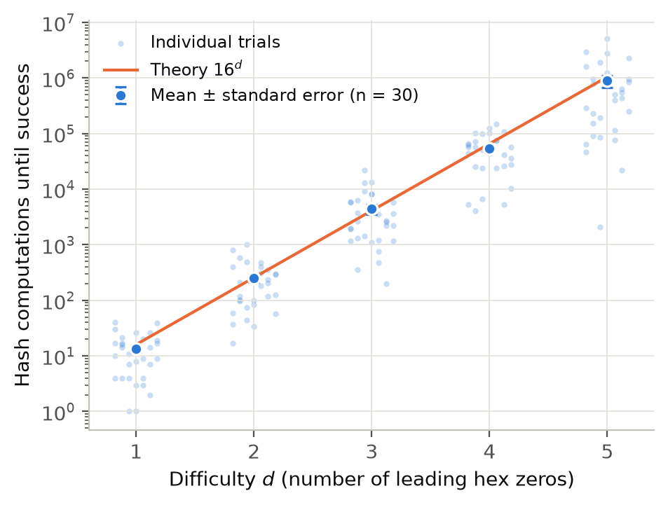
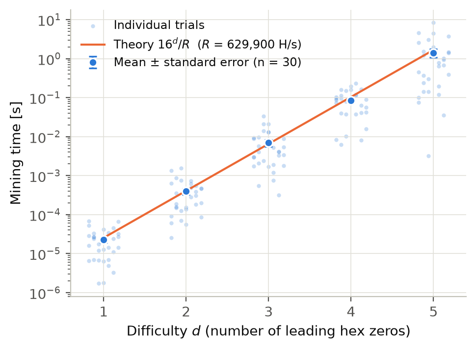
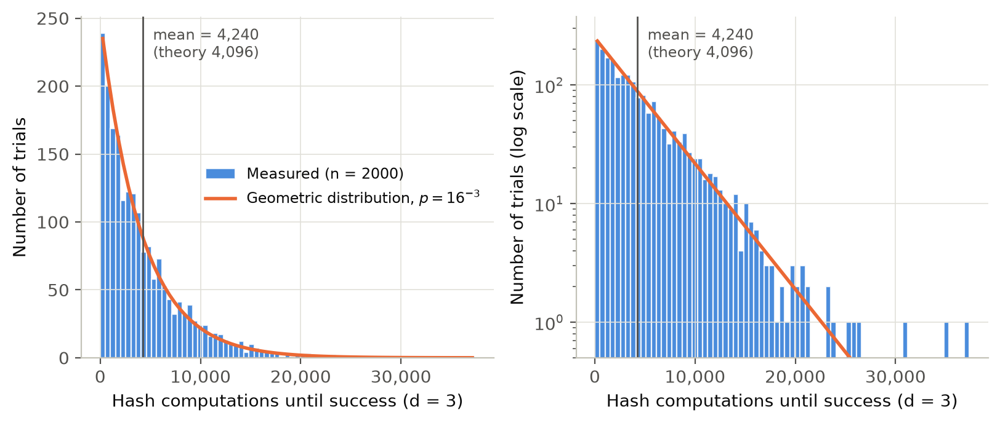

# 実験結果と考察

計測日時: 2026-10-22（JST）
計測環境: Apple M5 Pro、macOS 26.6.2（arm64）、Python 3.12.14
生データ: `data/results/`（CSV / JSON）　図: `docs/figures/`（PNG / PDF）

再現方法: `just exp-pow`（実験1、約1分）、`just exp-tamper`（実験2）。ハッシュ計算回数はブロック内容を固定しているため、どの環境でも同じ値になります。時間は環境によって変わります。

## 実験1: PoW の difficulty と計算量

### 方法

- difficulty d = 1〜5 のそれぞれで、内容の異なるブロックを30回採掘し、成功までのハッシュ計算回数 K と時間を記録した。
- ブロックの内容は、payload の試行番号だけを変え、時刻などはすべて固定した。nonce は 0 から1ずつ増やす。
- 理論値: 1回の成功確率 p = 16^(−d)。K は幾何分布に従い、E[K] = 16^d、σ[K] = √(1−p)/p ≈ 16^d。
- z = (平均 − 16^d) / (σ[K]/√n)。理論値からのずれが理論上の標準誤差の何倍かを表す（中心極限定理による近似）。

### 結果

| d | 回数 n | 平均 K | 標準偏差 | 理論値 16^d | 平均/理論 | z | 中央値 | 理論中央値 | 平均時間 |
|---:|---:|---:|---:|---:|---:|---:|---:|---:|---:|
| 1 | 30 | 13.4 | 10.7 | 16 | 0.840 | −0.91 | 10.5 | 11 | 0.0224 ms |
| 2 | 30 | 251.1 | 235.8 | 256 | 0.981 | −0.10 | 194.5 | 178 | 0.396 ms |
| 3 | 30 | 4,451.4 | 4,812.7 | 4,096 | 1.087 | +0.48 | 2,578.5 | 2,839 | 6.91 ms |
| 4 | 30 | 54,470.3 | 37,747.7 | 65,536 | 0.831 | −0.92 | 52,980 | 45,426 | 84.9 ms |
| 5 | 30 | 888,336.1 | 1,139,330.6 | 1,048,576 | 0.847 | −0.84 | 466,052.5 | 726,818 | 1,412 ms |

図1: difficulty とハッシュ計算回数（縦軸は対数）。薄い点は個々の試行、濃い点は平均 ± 標準誤差、橙線は理論値 16^d。

図2: difficulty と採掘時間（縦軸は対数）。橙線は 16^d / R（R = 全試行の合計ハッシュ計算回数 ÷ 合計時間 = 約63万回/秒）。

図3: d = 3 で2000回採掘したときの試行回数の分布。左は線形軸、右は片対数軸。橙線は幾何分布から計算した各区間の期待度数。

| d = 3、n = 2000 | 実測 | 理論 |
|---|---:|---:|
| 平均 | 4,239.8 | 4,096 |
| 標準偏差 | 4,208.0 | 4,095.5 |
| 中央値 | 3,039.5 | 2,839 |
| z | +1.57 | — |

### 考察

1. **平均試行回数は 16^d に一致する。** 片対数グラフで平均値は直線に並ぶ（図1）。log10(平均) を d に対して最小二乗法で直線近似すると、傾きは 1.198 になる（理論値 log10 16 = 1.204）。傾きから推定される底は 15.8 で、理論値 16 に近い。5つの z はすべて |z| < 1 で、χ² = Σz² = 2.6（自由度5、p ≈ 0.76）であり、理論値との有意なずれは見られない。

2. **ばらつきが大きいのは、幾何分布の標準偏差が平均とほぼ等しいためである。** 個々の試行は、同じ d でも1〜2桁の範囲に散らばる（図1の薄い点。d = 5 では最小 2,100 回、最大 5,074,708 回）。n = 30 回の平均の相対標準誤差は理論上 1/√30 ≈ 18% なので、平均/理論 が 0.83〜1.09 の範囲に収まるのは、この大きさのばらつきと整合する。平均値の精度を上げるには試行回数を増やす必要があり、誤差を半分にするには4倍の試行が必要になる。

3. **試行回数の分布は幾何分布（連続極限では指数分布）に従う。** 図3の片対数グラフで度数が直線的に減少することは、分布が指数関数型であることを示す。これは放射性崩壊の待ち時間と同じ形である。ハッシュ計算の1回1回が独立な試行で、成功確率が毎回同じであるため、次の性質を持つ。
   - **無記憶性**: それまでに何回失敗していても、成功までに必要な残りの試行回数の期待値は常に 16^d である。採掘には「途中までの進み具合」がない。
   - 右に裾の長い分布なので、中央値（≈ ln 2 × 16^d ≈ 0.69 × 16^d）は平均より小さい。「典型的な1回」は平均より早く終わり、まれに非常に長くかかる試行が平均を押し上げる。
   - 多数の採掘者がいるネットワークでは、ブロックの発見はポアソン過程になり、ブロック間隔は指数分布に従う（本実装では未検証。今後の課題の候補）。

4. **時間は試行回数に比例する。** ハッシュレートは d によらずほぼ一定（d = 2〜5 で 63万〜64万回/秒）なので、時間も 16^d に比例して増える（図2。直線近似で推定した底は 15.6）。d = 1 のハッシュレートは 60万回/秒とやや低い。1回の採掘が約20マイクロ秒と短いため、時間計測などの固定的な処理時間の影響が相対的に大きくなったと考えられる（推測であり、未検証）。

## 実験2: 改ざんの検出

### 方法

difficulty = 4、Genesis + 5 ブロックの正しいチェーンを作り、そのコピー（`copy.deepcopy`）に対して、ブロック#2 の最初のトランザクションの値（`value_mK`: 295170 → 999999）を書き換えた。改ざんする側が行う処理の量を4段階に変え、それぞれのチェーンを検証した。

### 結果

| シナリオ | 改ざんする側が行う処理 | 検証結果 | 検出したエラー |
|---|---|---|---|
| 1 | payload を書き換えるだけ | 検出 | #2: transaction_id が内容と不一致 / #2: hash が内容から再計算した値と不一致 |
| 2 | さらに transaction_id と hash を再計算（PoW なし） | 検出 | #2: PoW 条件（先頭 0000）を満たさない / #3: previous_hash が不一致 |
| 3 | さらに改ざんしたブロックだけ PoW をやり直す | 検出 | #3: previous_hash が不一致 |
| 4 | 改ざんしたブロック以降（#2〜#5）をすべて PoW でやり直す | **通過** | なし |

- シナリオ4で掘り直したブロック数は4、ハッシュ計算回数は 267,705 回だった（期待値 4 × 16^4 = 262,144 回）。
- 元のチェーンは変更されておらず、検証も通過した（コピーに対して改ざんしたため）。

### 考察

- 1つのブロックを書き換えると、そのブロックのハッシュが変わり、後続のブロックとのつながりが切れる。改ざんを隠すには、そのブロック以降をすべて採掘し直す必要がある。必要な計算量は、掘り直すブロック数 k に比例して約 k × 16^d 回になる。
- シナリオ4が示すように、検証で確認できるのは「チェーンが内部的に整合しているか」までである。改ざん後に掘り直したチェーンと元のチェーンは、どちらも検証を通過する。どちらを正当とみなすかは、ネットワーク上の合意（PoW では累積仕事量が最大のチェーンを選ぶ規則）で決まる。ブロックチェーンの安全性は、ハッシュの連結だけでなく、「正直な参加者の計算能力が攻撃者を上回る」という前提にも依存している。本実装は合意形成を実装していないため、この点は扱っていない。

## 制約

- 計測は1台の計算機で1回ずつ行った。時間の値は、実行環境や同時に動いている他の処理の影響を受ける。
- z と χ² は、中心極限定理による正規近似に基づく。n = 30 は、裾の長い分布に対しては近似の精度が十分とはいえない可能性がある。
- 実験1の試行は、ブロック内容の試行番号を変えて作った標本である。SHA-256 の出力を一様乱数とみなす仮定の上で、独立な試行として扱っている。
